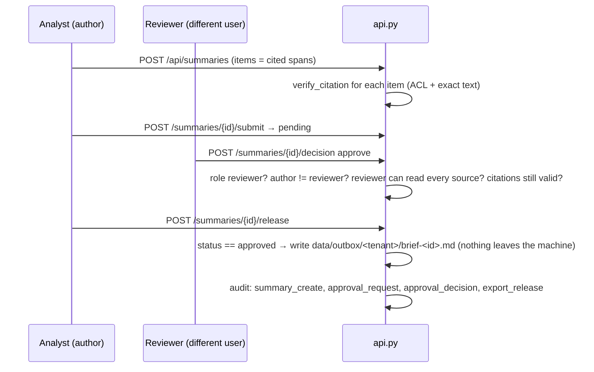

# Architecture

One Python service (FastAPI + SQLAlchemy over SQLite) and one Next.js app that proxies `/api` to it.
Everything runs locally on CPU; the optional generator is whatever OpenAI-compatible server is running locally.

## Components

```mermaid
flowchart TB
  subgraph web["web/ (Next.js 16, React 19, TypeScript) :5111"]
    WB[Workbench: Scope → Ask → Verify → Compare → Brief → Approve]
    LIB[Library + document viewer + lineage drawer]
    LAB[Evaluation & Trust Console]
    ADM[Admin: audit, quarantine, upload, delete]
  end
  subgraph api["src/inkfall (FastAPI) :5110"]
    A[api.py: sessions, limits, routes, audit hooks]
    AC[access.py: authorized view]
    AZ[authz.py: decide()]
    S[search.py: BM25 / dense / RRF hybrid / rerank]
    E[evidence.py: pack, extractive answer, abstention, conflicts, injection flags, graph]
    G[generate.py + providers.py: optional local LLM + validator]
    I[ingest.py: parse, quarantine, version, chunk]
    AU[audit.py + redact.py]
    SV[service.py: run_query, compare, verify_citation]
    EV[evaluate.py / adversarial.py: reports with provenance]
  end
  DB[(SQLite: tenants, documents, document_versions, chunks + embeddings,<br/>chunks_fts_<tenant> (FTS5), sessions, audit_events, quarantine, reviews, summaries)]
  ST[sentence-transformers all-MiniLM-L6-v2 (CPU)]
  LLM[LM Studio / Ollama (optional)]
  web -- "/api/* rewrite (same origin, HttpOnly cookie)" --> A
  A --> SV --> AC --> AZ
  SV --> S --> DB
  S --> ST
  SV --> E
  SV --> G --> LLM
  A --> I --> DB
  A --> AU --> DB
  EV --> SV
```

## Request sequence: ask a question

```mermaid
sequenceDiagram
  participant U as Browser
  participant API as api.py
  participant ACC as access.authorized_versions
  participant S as search.py
  participant E as evidence.py
  participant M as Local model (optional)
  participant L as audit
  U->>API: POST /api/ask {question, as_of, method, generate}
  API->>API: session → User (server-side); body extra=forbid; rate limit
  API->>ACC: user, as_of, collection, include_history
  ACC->>ACC: load ONLY caller's tenant rows; decide() per version; temporal filter
  ACC-->>API: authorized versions (+ reasons)
  API->>S: query, authorized chunk ids
  S->>S: FTS5 MATCH in chunks_fts_<tenant> AND chunk_id IN authorized
  S->>S: cosine over authorized embeddings only; RRF fuse
  S-->>E: ranked hits (unauthorized ids dropped again defensively)
  E->>E: source pack (6 passages) · verbatim sentences + offsets · coverage/abstain · conflict rule · injection flags · graph
  opt generate != extractive and not abstained
    E->>M: system rules + authorized passages as data (no tools)
    M-->>E: JSON {sentences:[{text, cites}]}
    E->>E: reject unknown ids · support check per sentence · anchor to stored spans
  end
  API->>L: ask/generate event (redacted query, refs, outcome; never passage text)
  API-->>U: answer + citations + trust + retrieval diagnostics + graph
```

## Sequence: brief approval and release (the one "external" action)



## Data model highlights

- `documents` (tenant, doc_key) → `document_versions` (immutable text, sha256, ACL labels, effective date,
  amends, retention, lineage) → `chunks` (char_start/char_end into the version text, heading, embedding).
- Invariant, tested over every chunk: `version.text[char_start:char_end] == chunk.text`.
- A version is *in force* on date D if it is the highest active version with `effective_date <= D`.
  Future-dated versions are never retrievable before their date.
- Deletion is soft for versions (kept for audit, status `deleted`, denied by authz) and hard for chunks, FTS rows
  and embeddings, so stale hits disappear.

## Retrieval details

| Stage | Implementation |
|---|---|
| Normalization | NFKC, control chars stripped, 500-char cap; stop/filler words and dates removed for coverage |
| Lexical | SQLite FTS5 (`porter unicode61`), bm25 with weights title 2, heading 3, body 1; each query term quoted (no FTS operator injection); small plain-language synonym map |
| Dense | `sentence-transformers/all-MiniLM-L6-v2` (Apache-2.0, 384-d), normalized, cosine in NumPy over authorized chunks only |
| Hybrid | Reciprocal-rank fusion, k = 60 |
| Rerank | `cross-encoder/ms-marco-MiniLM-L6-v2` over the top 20 hybrid hits, opt-in (`make rerank-model`); measured: no gain over hybrid on this corpus at ~10x latency (docs/RETRIEVAL_EVAL.md) |
| Source pack | top 6 chunks, max 3 per version |

## Where the security boundary is

`access.authorized_versions` / `access.get_authorized_version` → `authz.decide`. Everything else (search, the
model, the UI) is downstream of it and is treated as untrusted with respect to access decisions.
